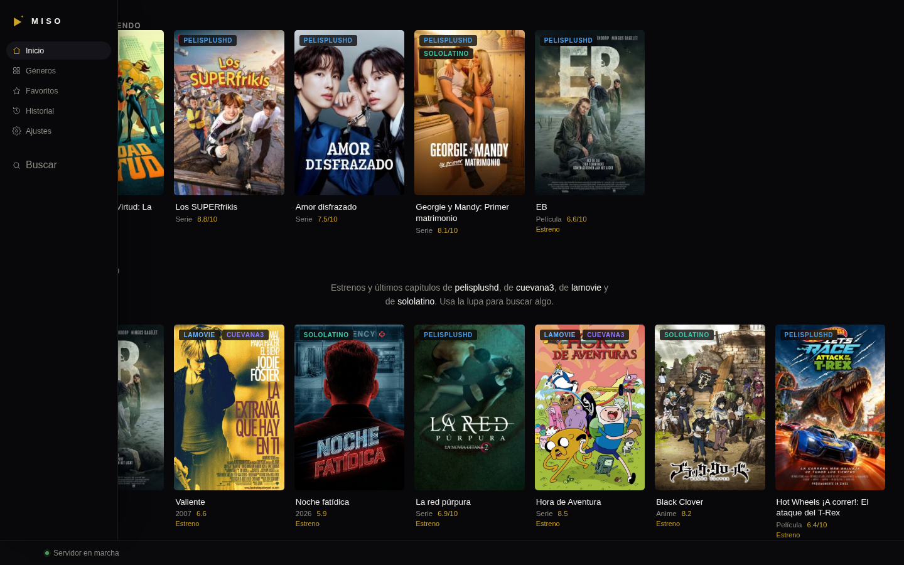
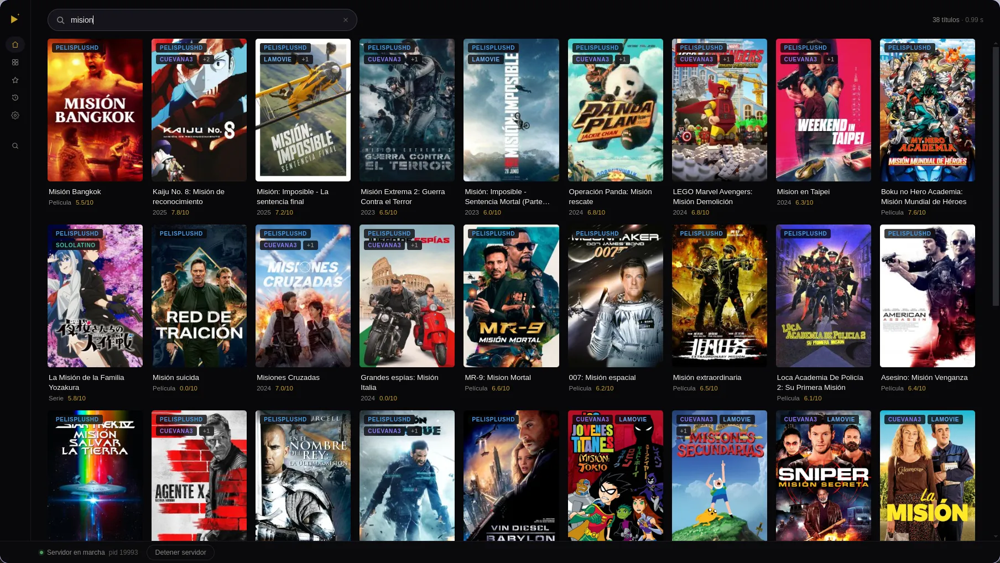
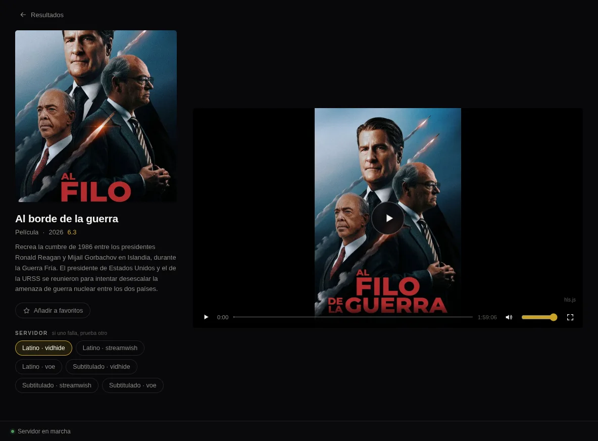
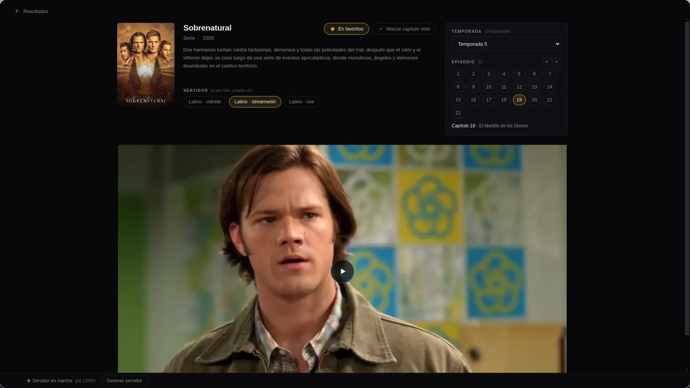
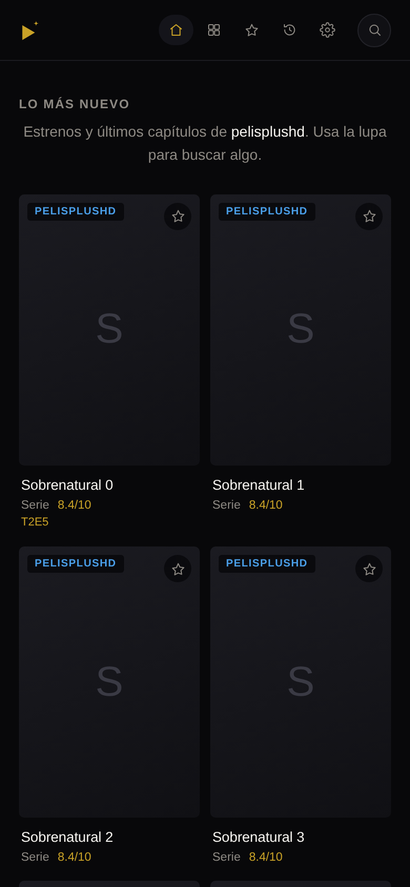
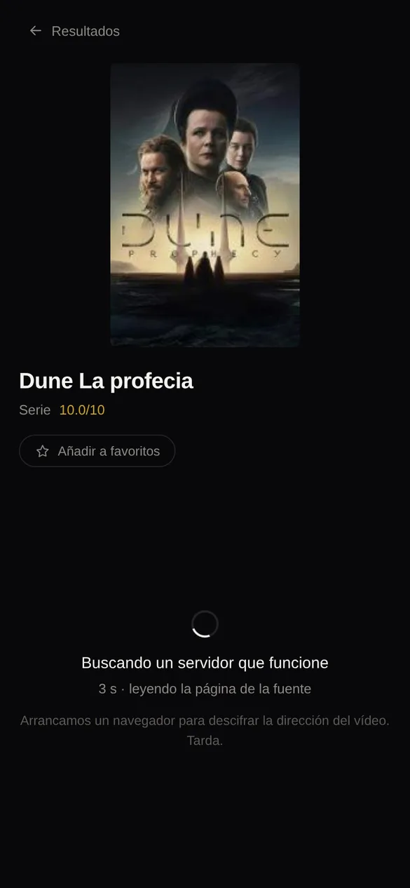

<p align="center">
  
</p>

# Miso

**Buscador federado de streaming, local y de escritorio.**

Miso busca el mismo título en varias webs de streaming a la vez, unifica los
resultados en una sola cuadrícula y reproduce el vídeo **sin salir de la
aplicación**: sin pestañas, sin ventanas emergentes y sin publicidad.

No es un sitio web. Se abre desde un acceso directo, levanta su propio servidor
Node local y lo apaga cuando la aplicación se cierra.

---

## Qué hace

- **Búsqueda federada** en varias fuentes simultáneamente, con los resultados
  mezclados y ordenados por relevancia.
- **Resultados unificados**: el mismo título encontrado en distintas fuentes se
  agrupa en una sola tarjeta (la insignia `+N` indica las fuentes alternativas).
- **El nombre de la fuente siempre visible** en cada tarjeta.
- **Reproducción dentro de la app**, mediante proxies locales de imagen y de HLS
  que resuelven el problema de CORS de los CDN.
- **Reconexión automática**: si el enlace del servidor caduca a mitad de película,
  la app vuelve a resolver el mismo servidor, obtiene uno fresco y **continúa
  desde donde ibas**, sin devolverte a elegir servidor.
- **Fichas de series** con temporadas y capítulos navegables.
- **Búsqueda por género**: un catálogo fijo que se consulta en todas las fuentes a
  la vez, con filtro por película, serie o anime.
- **Favoritos e historial**, guardados en la carpeta de datos de tu usuario (no en
  la nube) y con «Continuar viendo» en la pantalla de inicio. Sobreviven al cierre
  de la aplicación.
- **Tema oscuro** fijo y **detalle técnico solo cuando algo falla**.
- **Sin rastreadores, sin cuentas, sin publicidad.** Todo ocurre en tu equipo.

## Capturas

<p align="center">
  
  
</p>
<p align="center">
  
  
</p>

### En móvil (Android)

<p align="center">
  
  
</p>

## Fuentes soportadas

| Fuente | Etiqueta | Extracción |
| --- | --- | --- |
| PelisPlusHD | `pelisplushd` | HTML + navegador (URL calculada en JS ofuscado) |
| Cuevana3 | `cuevana3` | API `/wp-api/v1` |
| LaMovie | `lamovie` | API `/wp-api/v1` |
| SoloLatino | `sololatino` | API `/api/search/suggest` + HTML (JSON-LD) |

> Las fuentes **rotan de dominio con frecuencia**. Miso resuelve en tiempo de
> ejecución cuál de sus dominios conocidos está vivo, así que el dominio real no
> se fija en el código.

Miso **no aloja ni distribuye contenido**: es un cliente que consulta sitios de
terceros y reproduce lo que estos ya publican.

---

## Requisitos

**Para usar la app ya empaquetada** no hace falta instalar nada más:

- Windows 10/11 (x64) o Linux x64.
- Chromium va incluido en el paquete, no se descarga al arrancar.

**Para desarrollar o compilar desde el código:**

- Node.js 22 o superior y npm.
- Linux o Windows (para empaquetar Windows desde Linux hace falta `wine`).

---

## Instalación

### Usuario final

Descarga el artefacto de la última release y ejecútalo:

- **Windows** — `Miso-0.1.0-x64.exe`
  - Instalador NSIS (crea accesos directos en escritorio y menú inicio) o
    versión `portable` sin instalación.
- **Linux**
  - `Miso-0.1.0-x86_64.AppImage` (dale permisos de ejecución la primera vez):

  ```bash
  chmod +x Miso-0.1.0-x86_64.AppImage
  ./Miso-0.1.0-x86_64.AppImage
  ```

  - Si al compilar prefieres un ejecutable suelto, la carpeta
    `dist/release/linux-unpacked/` contiene un `miso` ya autocontenido (con
    Chromium al lado). Es el modo recomendado en Linux: no depende de FUSE.

- **Android (Termux)** — sin APK. Usa el servidor en el propio teléfono.

  1. Instala [Termux](https://f-droid.org/es/packages/com.termux/) (recomendado desde F-Droid).
  2. Actualiza e instala Node: `pkg update && pkg install nodejs`
  3. Da acceso a descargas: `termux-setup-storage`
  4. Descomprime el paquete de Termux: `tar -xzf ~/storage/downloads/miso-termux-0.1.0.tar.gz -C ~`
  5. Arranca: `sh ~/miso/miso.sh`

  El script abre el navegador del teléfono en `http://127.0.0.1:7345`, guarda favoritos e historial en `~/.miso` y solicita un wake-lock mientras la app está en uso. Puedes añadirlo a la pantalla de inicio con Termux:Widget.

  > En el paquete de Termux el navegador headless no está presente, así que los servidores que lo necesitan se omiten. El resto funciona sin cambios.

Al abrir, Miso arranca su servidor local y muestra la pantalla de inicio con los
estrenos y últimos capítulos más recientes.

## Uso

1. Escribe el título en el buscador y pulsa Enter.
2. La cuadrícula muestra los resultados de todas las fuentes. Cada tarjeta lleva
   la insignia de la fuente.
3. Pulsa una tarjeta para abrir la ficha. Si hay varias fuentes para el mismo
   título, se listan como servidores alternativos.
4. En series, elige temporada y capítulo.
5. Pulsa **Reproducir**. El vídeo se abre dentro de la app.
6. Si un servidor falla al abrir, la app prueba el siguiente automáticamente.
7. Si el enlace caduca mientras ves algo, la app se reconecta sola y continúa
   desde el mismo punto. Durante ese momento verás **«Reconectando…»** sobre el
   vídeo.

### Diagnóstico

Los fallos del reproductor y del proxy de vídeo se anotan en un registro dentro
de la carpeta de datos del usuario:

- Linux/Termux: `~/.config/miso/miso.log` (siempre que uses `MISO_USER_DATA` por defecto, Termux usa `~/.miso` para `MISO_USER_DATA=${MISO_USER_DATA:-$HOME/.miso}` en el lanzador; el registro va a `~/.miso/miso.log`).
- Windows: `%APPDATA%\Miso\miso.log`

```bash
tail -f ~/.config/miso/miso.log
```

Es lo primero que conviene mirar si algo deja de reproducirse: indica si el origen
respondió `403`/`504`, si devolvió HTML en vez de un manifiesto o si fue el propio
reproductor el que se rindió. El estado de la biblioteca también se puede consultar
en `GET /api/health` (campo `library`).

---

## Desarrollo

```bash
# 1. Dependencias
npm ci

# 2. Chromium para la extracción (playwright-core no lo descarga solo)
npx playwright install chromium

# 3. Modo desarrollo (servidor + Vite con recarga en caliente)
npm run dev

# 4. Compilar y ejecutar en modo producción
npm run build
npm start
```

### Scripts

| Script | Qué hace |
| --- | --- |
| `npm run dev` | Servidor de desarrollo con recarga en caliente. |
| `npm run build` | Compila web, servidor y proceso de Electron. |
| `npm run build:termux` | Genera el paquete de Termux (`dist/termux/miso-termux-*.tar.gz`). |
| `npm start` | Abre la app de escritorio (`electron .`). |
| `npm run typecheck` | Comprobación de tipos (servidor y web). |
| `npm run check` | Comprobaciones offline de codificación y parsers. |
| `npm run check:vivo` | Prueba en vivo contra un servidor ya arrancado. |
| `npm run check:arranque` | Comprueba el arranque de la app. |
| `npm run check:extract` | Comprueba la extracción de streams. |

Ejemplo de comprobación en vivo:

```bash
npm run build:server
MISO_PORT=8791 node dist/server.mjs &
npm run check:vivo -- http://127.0.0.1:8791
```

### Empaquetado

```bash
npm run build
npx electron-builder --linux          # AppImage + .deb
npx electron-builder --win            # NSIS + portable (requiere Windows o wine)
```

Los artefactos se generan en `dist/release/`.

> **Nota:** la configuración de `package.json` (`build.extraResources`) copia
> Chromium desde la caché local de Playwright. Para empaquetar en otra máquina,
> ajusta esas rutas o define el ejecutable con la variable de entorno
> `PLAYWRIGHT_CHROMIUM_EXECUTABLE_PATH`.

---

## Arquitectura

```
┌───────────────────────────────────────────────┐
│ Electron (proceso principal)                   │
│  · abre la ventana                             │
│  · arranca y vigila el servidor local          │
└───────────────┬───────────────────────────────┘
                │
┌───────────────▼───────────────────────────────┐
│ Servidor Node local (Express, puerto 7345)     │
│  · /api/search   búsqueda federada             │
│  · /api/home     estrenos de las fuentes       │
│  · /api/genres   catálogo de géneros           │
│  · /api/genre    un género, federado           │
│  · /api/library  historial y favoritos         │
│  · /api/log      diagnóstico del reproductor   │
│  · /api/detail   ficha y servidores            │
│  · /api/hls      proxy HLS                     │
│  · /api/image    proxy de pósters              │
│  · extracción en cascada (HTML → embeds →      │
│    navegador headless con Playwright)          │
└───────────────┬───────────────────────────────┘
                │
┌───────────────▼───────────────────────────────┐
│ Interfaz React + Vite (servida por el server)  │
└───────────────────────────────────────────────┘
```

**Por qué un servidor local:** los CDN de pósters y de vídeo no envían cabeceras
CORS, así que un navegador normal no puede ni mostrar la imagen ni reproducir el
stream. Miso pone un proxy delante que valida que el destino sea público y sirve
el contenido como si fuera propio. La seguridad del navegador **no se desactiva
en ningún caso**.

**Extracción en cascada:** primero se busca la URL del vídeo en el HTML, luego en
los embeds (a veces en base64) y, si nada de eso basta, se carga la página en un
Chromium headless y se observan a la vez la red, el DOM y la configuración del
reproductor. Se para en cuanto algo resulta reproducible y se **valida** que el
HLS contenga vídeo real y no solo anuncios.

### Estructura del proyecto

```
electron/         Proceso principal y preload de Electron
server/
  index.ts        Arranque del servidor Express y rutas
  search.ts       Búsqueda federada
  home.ts         Estrenos de las fuentes
  genre.ts        Un género, federado
  genres.ts       Catálogo de géneros
  store.ts        Historial y favoritos (`library.json`, carpeta de datos)
  log.ts          Registro de diagnóstico (`miso.log`)
  http.ts         Cliente HTTP común
  cache.ts        Caché en memoria con TTL
  sources/        Adaptadores por fuente
  extract/        Extracción del stream (HTML, estático, navegador)
  proxy/          Proxies de imagen y HLS
web/              Interfaz React + Vite
scripts/          Comprobaciones y utilidades de desarrollo
```

---

## Limitaciones conocidas

- **Los hosters caducan y rotan.** Cuando una fuente dice que el fichero ya no
  existe, no hay nada que extraer; Miso prueba el siguiente servidor. Si el enlace
  caduca mientras ves algo, se reconecta solo y reanuda donde ibas.
- **Algunos hosts bloquean peticiones automatizadas** (respuesta 403). Miso no
  desactiva la seguridad del navegador ni sortea protecciones; en esos casos
  intenta otro servidor o deja el enlace para abrir la página original.
- La disponibilidad depende por completo de webs de terceros.

## Aviso legal

Miso no aloja, almacena ni distribuye contenido audiovisual. Es un cliente que
consulta y reproduce material publicado por terceros. Úsalo únicamente para
contenido de dominio público o sobre el que tengas derechos. Este repositorio no
concede licencia de uso sobre las obras de terceros.